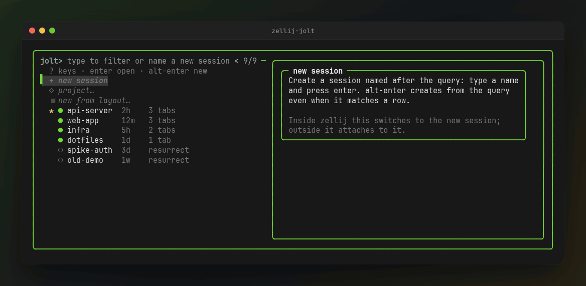
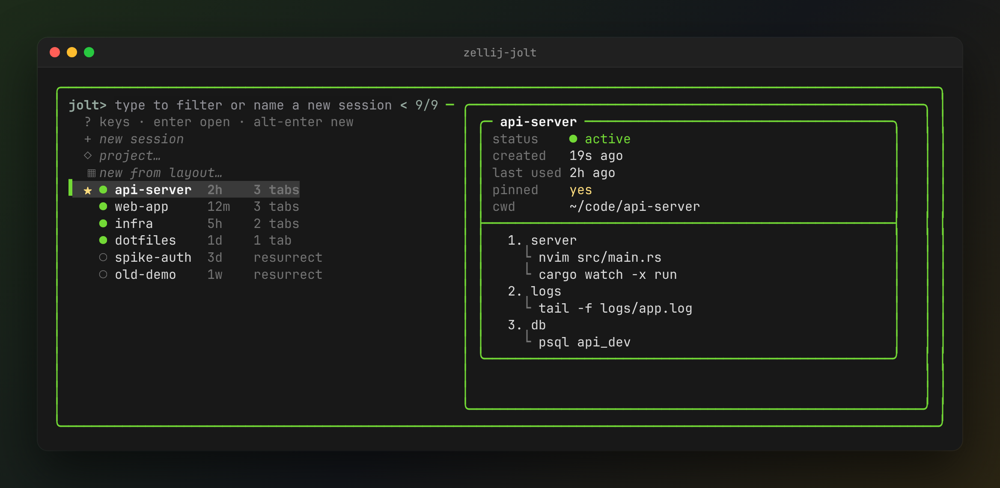
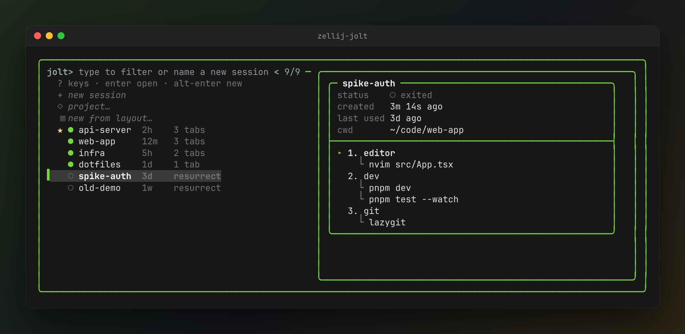
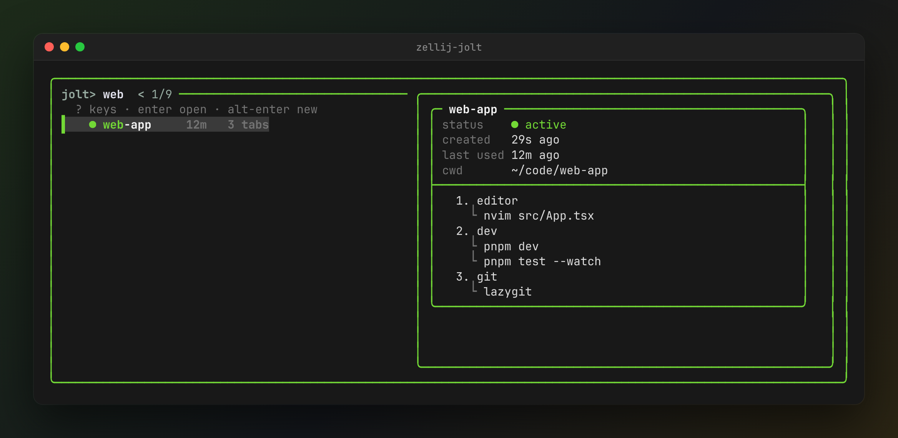
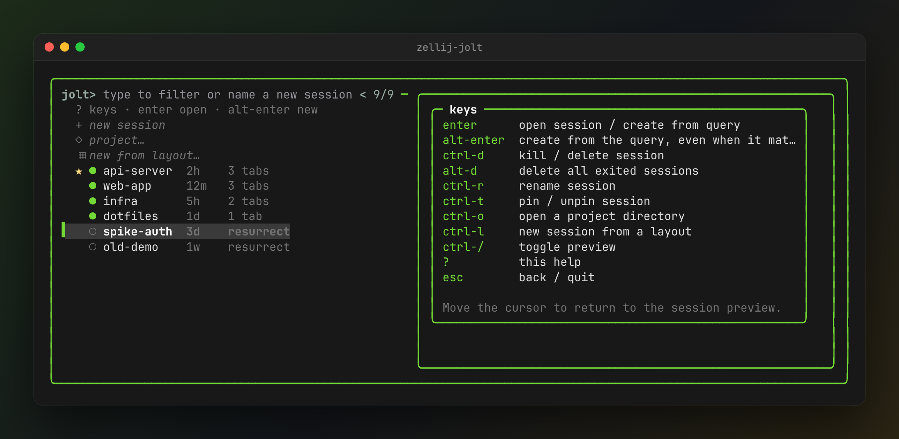
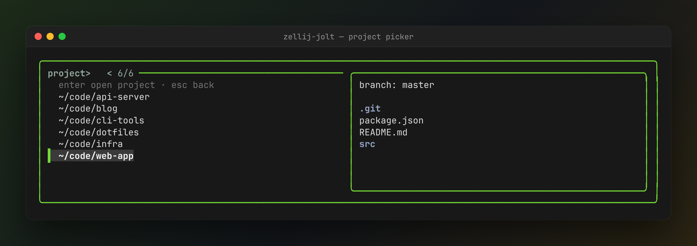
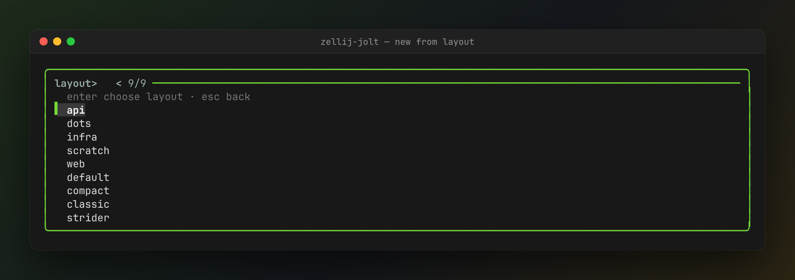

<div align="center">

# ⚡ Zellij-Jolt

**Jolt into your Zellij sessions — fuzzy picker, live preview, instant attach.**

[](https://github.com/AjayVasan/Zellij-Jolt/releases)
[](LICENSE)
[](#requirements)
[](https://zellij.dev)
[](https://github.com/junegunn/fzf)
[](test/)
[](https://www.shellcheck.net)



</div>

Zellij-Jolt turns your terminal into a keyboard-first launcher for [Zellij](https://zellij.dev). Open a terminal, and an `fzf` picker lists every session: pinned, active and exited. A live preview shows each session's tabs and running commands. From that one screen you can attach, create, rename, pin, delete, resurrect, or open a project or layout.

It's a **single bash script** with no daemon and no plugin. It reads Zellij's own session cache and only changes a session when you press a key.

## Quick start

```bash
git clone https://github.com/AjayVasan/Zellij-Jolt && cd Zellij-Jolt && ./install.sh
zellij-jolt
```

Then make it your terminal's shell or bind it inside Zellij. See [Setup](#setup).

## Features

| | |
|---|---|
| 🔎 **One fuzzy list** | Actions, pinned, active and exited sessions in one picker, ordered pinned → active → exited → current. Type a name that doesn't exist to create it. |
| 👁️ **Live preview** | Status, age, last used, cwd, and every tab with its panes' running commands (`▸` marks the active tab). |
| ♻️ **Resurrect** | Exited sessions stay in the list with their saved layout. Pick one to bring it back. |
| 📁 **Projects** | `ctrl-o` jumps into a git repo from `zoxide` or a scan of your project roots, with a branch and file preview. |
| 🧩 **Layouts** | `ctrl-l` starts a session from any `*.kdl` layout, including Zellij's built-ins. |
| ⌨️ **Session actions** | Delete, purge exited, rename and pin/unpin without leaving the picker. All keys are configurable. |
| 🎨 **Theme-aware** | Uses your Zellij theme's colors automatically. Respects `NO_COLOR`. |
| 🔀 **In-session switching** | Inside Zellij it uses `switch-session` instead of nesting. Bind it to `Alt s` as a floating pane. |
| 🤖 **Claude Code panes survive restarts** | Bundled `claude-zellij` makes a pane running `claude` reopen the same conversation when Zellij resurrects the session. See [Claude Code panes](#claude-code-panes). |
| 🩺 **Doctor & dry-run** | `--doctor` checks your environment. `--dry-run` prints the exact command it would run. |

## Screenshots

<table>
  <tr>
    <td width="50%"></td>
    <td width="50%"></td>
  </tr>
  <tr>
    <td align="center"><b>Unified picker</b>: pinned ★, active ●, exited ○, with a live preview</td>
    <td align="center"><b>Resurrect</b>: exited sessions keep their saved tabs and commands</td>
  </tr>
  <tr>
    <td></td>
    <td></td>
  </tr>
  <tr>
    <td align="center"><b>Fuzzy filter</b>: type to narrow, or press enter to create</td>
    <td align="center"><b>Built-in help</b>: press <code>?</code> for every key</td>
  </tr>
  <tr>
    <td></td>
    <td></td>
  </tr>
  <tr>
    <td align="center"><b>Project picker</b> (<code>ctrl-o</code>): git repos with a branch preview</td>
    <td align="center"><b>New from layout</b> (<code>ctrl-l</code>): your layouts plus the built-ins</td>
  </tr>
</table>

### Legend

`★` pinned · `●` active · `○` exited (resurrect) · `◆` current session

## Requirements

- `bash` ≥ 4.2 (macOS ships 3.2 — `brew install bash`, no need to change your login shell)
- `fzf` ≥ 0.38
- `zellij` ≥ 0.39 (≥ 0.44 to switch sessions from inside Zellij)
- Optional: `zoxide` (project picker), `fd` (project picker, faster directory scan)

## Install

```bash
git clone https://github.com/AjayVasan/Zellij-Jolt
cd Zellij-Jolt
./install.sh
```

This copies `zellij-jolt.sh` to `${XDG_DATA_HOME:-~/.local/share}/zellij-jolt/`, symlinks it at `${XDG_BIN_HOME:-~/.local/bin}/zellij-jolt`, checks dependency versions, and prints the config snippet for any terminal emulator it detects (see Setup below). On GNOME it also offers to register a keyboard shortcut (opt-in, skipped entirely under `--yes` or when stdin isn't a terminal; the shortcut opens zellij-jolt in the first terminal it finds — alacritty, kitty, wezterm, ghostty, foot or gnome-terminal — and is skipped when there is none).

```
Usage: install.sh [--yes] [--no-shortcut] [--no-claude] [--uninstall] [--help]

  --yes           Non-interactive: accept every default, never prompt.
  --no-shortcut   Skip the GNOME keyboard-shortcut question entirely.
  --no-claude     Don't install claude-zellij or its shell alias.
  --uninstall     Remove the installed script and symlink, then exit.
  --help          Show this help.

Stdin that isn't a terminal (e.g. piped input) behaves like --yes.
```

It also installs the bundled `claude-zellij` wrapper at `${XDG_BIN_HOME:-~/.local/bin}/claude-zellij` (an existing, different one is kept as `claude-zellij.bak`) and offers to add the alias described in [Claude Code panes](#claude-code-panes). `--no-claude` skips both.

`./install.sh --uninstall` removes the symlinks and install directory only — it never touches shell rc files, terminal config, or GNOME shortcuts.

Make sure `${XDG_BIN_HOME:-~/.local/bin}` is on your `PATH`.

## Setup

Pick one: make `zellij-jolt` your terminal's shell (so every new window opens the picker), or add the `--init-shell` snippet to your shell rc (so an interactive shell drops into the picker right after it starts). Either way, finish with the in-Zellij keybinding below so you can summon the picker without leaving a session.

**Alacritty** (`alacritty.toml`):
```toml
[terminal]
shell = "/home/you/.local/bin/zellij-jolt"
```

**Ghostty** (`config`):
```
command = /home/you/.local/bin/zellij-jolt
```

**Kitty** (`kitty.conf`):
```
shell /home/you/.local/bin/zellij-jolt
```

**WezTerm** (`wezterm.lua`):
```lua
config.default_prog = { "/home/you/.local/bin/zellij-jolt" }
```

**foot** (`foot.ini`):
```ini
[main]
shell=/home/you/.local/bin/zellij-jolt
```

**Shell rc alternative** — instead of replacing the terminal's shell, add a guarded auto-start line to your interactive shell's rc file:

```bash
zellij-jolt --init-shell zsh >> ~/.zshrc   # or bash / fish
```

This only fires outside Zellij/tmux, on a real tty, in an interactive shell, when `$TERM` isn't `dumb` or `vscode`, and when `JOLT_SKIP` isn't set — so it's safe to leave in your rc permanently.

**In-Zellij keybinding** — add to your Zellij `config.kdl` so `Alt s` opens the picker as a floating pane without leaving your session:

```kdl
keybinds {
    shared_except "locked" {
        bind "Alt s" { Run "zellij-jolt" { floating true; close_on_exit true; }; }
    }
}
```

## Claude Code panes

When Zellij resurrects a session (after a reboot, or when you pick an exited session in Zellij-Jolt), it re-runs each pane's saved command. For `claude` that starts a *new* conversation. The bundled `claude-zellij` wrapper fixes that: it gives each pane an ID that Zellij saves with the command, remembers which conversation the pane had open (following `/resume` and `/clear`), and resumes it on restore.

The installer adds this to your shell rc (`~/.zshrc`, `~/.bashrc`, or a fish `conf.d` file) — only if the rc doesn't already mention `claude-zellij`, so an existing setup is left alone:

```bash
# claude-zellij (zellij-jolt): inside Zellij, `claude` reopens its
# conversation when Zellij restores the pane.
if [[ -n ${ZELLIJ:-} ]] && command -v claude-zellij >/dev/null 2>&1; then
    alias claude='claude-zellij'
fi
```

The alias adds no flags of its own; anything you type after `claude` is passed through. Outside Zellij, and for `claude -p`, `--version` and subcommands like `claude mcp`, the wrapper just runs `claude`. A `claude --resume ID` or `--continue` pane is wrapped too, so it also comes back after a restore. Conversation records live in `${XDG_DATA_HOME:-~/.local/share}/claude-zellij/` and are dropped after 60 days (`CLAUDE_ZELLIJ_KEEP_DAYS`). Set `CLAUDE_ZELLIJ_BIN` to run a specific `claude` binary.

## Keys

| Key | Action | Config override |
|---|---|---|
| `enter` | open the selected session / create the typed name | — |
| `alt-enter` | create a session named after the query | `KEY_CREATE` |
| `ctrl-d` | kill / delete the selected session | `KEY_DELETE` |
| `alt-d` | delete all exited sessions | `KEY_PURGE` |
| `ctrl-r` | rename the selected session | `KEY_RENAME` |
| `ctrl-t` (`alt-t` inside Zellij) | pin / unpin the selected session | `KEY_PIN` |
| `ctrl-o` (`ctrl-e` inside Zellij) | open a project directory as a session | `KEY_PROJECT` |
| `ctrl-l` | new session from a layout | `KEY_LAYOUT` |
| `ctrl-/` | toggle the preview | `KEY_PREVIEW` |
| `?` | key help in the preview | `KEY_HELP` |
| `esc` | back / quit | — |

Inside Zellij, its default keymap takes `ctrl-o` (session mode) and `ctrl-t` (tab mode) before the picker sees them, so those two default to `ctrl-e` and `alt-t` there. A `KEY_*` you set yourself is used everywhere.

Override values must be plain fzf key names (`ctrl-d`, `alt-enter`, `ctrl-/`, `?`, `f1`, …); anything else is rejected with a warning and falls back to the default.

## Configuration

File: `${XDG_CONFIG_HOME:-~/.config}/zellij-jolt/config`, plain `KEY=VALUE` lines (`#` comments, blank lines ignored). Only the keys below are recognized — unknown keys and malformed lines are warned about and skipped. Values are taken literally (no shell expansion, no sourcing/eval), except a leading `~` or `~/` is expanded to `$HOME`.

| Key | Default | Meaning |
|---|---|---|
| `PROJECT_ROOTS` | `~/projects ~/code ~/src ~/dev` | Space-separated parent directories scanned for git repositories by the project picker (`ctrl-o`), used when `zoxide` has no candidates. If none of them exist, your home directory is scanned instead (hidden dirs and `node_modules` skipped) |
| `PROJECT_DEPTH` | `3` | Max directory depth to search under each root when `fd`/`find` is used |
| `DEFAULT_LAYOUT` | *(empty)* | Layout name applied to new sessions created via the project picker |
| `PREVIEW` | `on` | `on`/`off` — show the preview pane |
| `PREVIEW_POS` | `right` | `right`/`left`/`top`/`bottom` — preview pane position (invalid values fall back to `right`) |
| `SHOW_EXITED` | `on` | `on`/`off` — list exited sessions (pinned ones always show) |
| `THEME` | `auto` | `auto` (read from Zellij config), `none` (no color), or a specific Zellij theme name. Your own themes and Zellij's built-in ones (`dracula`, `catppuccin-mocha`, `tokyo-night`, …) both work; a built-in theme is read once from the `zellij` binary and cached in `~/.cache/zellij-jolt/themes/` |
| `CONFIRM_DELETE` | `on` | `on`/`off` — confirm before delete/kill/purge |
| `KEY_DELETE` | `ctrl-d` | Keybinding override, see Keys above |
| `KEY_PURGE` | `alt-d` | Keybinding override |
| `KEY_RENAME` | `ctrl-r` | Keybinding override |
| `KEY_PIN` | `ctrl-t` | Keybinding override |
| `KEY_PROJECT` | `ctrl-o` | Keybinding override |
| `KEY_LAYOUT` | `ctrl-l` | Keybinding override |
| `KEY_PREVIEW` | `ctrl-/` | Keybinding override |
| `KEY_HELP` | `?` | Keybinding override |
| `KEY_CREATE` | `alt-enter` | Keybinding override |

Example:

```
PROJECT_ROOTS=~/code ~/work
PROJECT_DEPTH=4
DEFAULT_LAYOUT=dev
PREVIEW_POS=bottom
SHOW_EXITED=off
THEME=none
KEY_DELETE=ctrl-x
```

## CLI reference

```
zellij-jolt                         picker (default)
zellij-jolt --list                  print picker rows (used by fzf reload)
zellij-jolt --preview KEY           render preview for a row key
zellij-jolt --action ACT KEY        keybind handler: delete|rename|pin|purge
zellij-jolt --dry-run               print final zellij command instead of exec
zellij-jolt --init-shell SHELL      print guarded auto-start snippet (bash|zsh|fish)
zellij-jolt --doctor                environment diagnostics
zellij-jolt --version | --help
zellij-jolt --preview-dir DIR       (internal) project preview listing
```

`--preview`, `--list`, `--action` and `--preview-dir` are internal callbacks used by fzf (preview, reload and keybind handlers); you won't normally run them by hand. `--dry-run` runs the picker but prints the `zellij`/`exec` command it would have run instead of executing it — useful for checking what a selection will actually do.

## Troubleshooting

- **Preview shows errors / garbled output under zsh** — fixed in v2 (the preview callback now re-invokes the script by absolute path instead of relying on `$SHELL`, which broke under zsh in v1).
- **`bash: command not found` or version errors on macOS** — macOS ships bash 3.2. Install a newer one with `brew install bash`; you don't need to change your login shell, Zellij-Jolt will use it directly.
- **Running it from inside a Zellij session** — Zellij-Jolt detects `$ZELLIJ` and uses `zellij action switch-session` instead of starting a nested session. Selecting the session you're already in is a no-op. `switch-session` needs zellij ≥ 0.44; on older versions Zellij-Jolt says so — detach first (Ctrl-o d) and run it outside.
- **Something looks wrong with versions, theme, or paths** — run `zellij-jolt --doctor`:
  ```
  bash 5.3.20 (ok)
  fzf 0.74.5 (ok)
  zellij 0.45.1 (ok)
  cache dir /home/you/.cache/zellij/contract_version_1/session_info
  theme gruber-darker (legacy palette)
  zoxide missing
  fd missing
  config /home/you/.config/zellij-jolt/config (not found, using defaults)
  state /home/you/.local/state/zellij-jolt
  claude-zellij /home/you/.local/bin/claude-zellij
  claude /home/you/.local/bin/claude
  ```
- **Restored `claude` pane says `permission denied`** — the pane ran a `claude` that isn't executable, usually `/usr/bin/claude` left behind by a broken `npm install -g @anthropic-ai/claude-code`. It happens when the terminal starts Zellij-Jolt directly: no rc file runs, so PATH lacks `~/.local/bin`. Zellij-Jolt now puts `~/.local/bin` (and `~/bin`, `$XDG_BIN_HOME`) back on PATH before starting Zellij, and `claude-zellij` skips non-executable copies. `--doctor` lists every `claude` on PATH and flags broken ones; remove the stale copy (e.g. `sudo npm rm -g @anthropic-ai/claude-code`) to be sure. Sessions already running keep their old PATH until the Zellij server restarts.
- **Project picker (`ctrl-o`) is empty** — without `zoxide`, it scans `PROJECT_ROOTS`, or your home directory when none of those exist, up to `PROJECT_DEPTH` levels. Set `PROJECT_ROOTS` to where your repos live, or raise `PROJECT_DEPTH`.
- **A restored session reopens the picker** — if you run Zellij-Jolt inside a session and switch away, Zellij's periodic snapshot could still record the picker pane. Zellij-Jolt now asks Zellij to re-save the session a second after it leaves (`zellij action save-session`; present in Zellij 0.45.1, silently skipped where missing).
- **Don't want auto-start in a particular shell** — set `JOLT_SKIP=1` before that shell starts; the `--init-shell` snippet checks for it and no-ops.

## How it works

Zellij-Jolt reads Zellij's own session list (`zellij list-sessions`) and its on-disk session cache (`${XDG_CACHE_HOME:-~/.cache}/zellij/contract_version_*/session_info`) to build the picker and preview — it never creates, modifies, or deletes a session on its own. Every session mutation (delete, purge, rename, pin, attach, create) happens only in direct response to a key you press or a session you select.

## Uninstall

```bash
./install.sh --uninstall
```

Then remove any terminal config snippet or `--init-shell` line you added, and delete `${XDG_CONFIG_HOME:-~/.config}/zellij-jolt` and `${XDG_STATE_HOME:-~/.local/state}/zellij-jolt` if you want to drop your config/MRU/pins too.

## Roadmap

**M2 — Ship**: AUR (stable + `-git`), Homebrew tap, Nix package, curl installer, man page, shell completions, CI (Linux + macOS, shellcheck, shfmt), comparison table.

**M3 — Differentiators**: live `dump-screen` preview, SSH remote sessions, git worktree/branch sessions, AI-agent status column, session notes, doctor-reap of zombie sessions.

## License

[MIT](LICENSE) © Ajay Vasan
